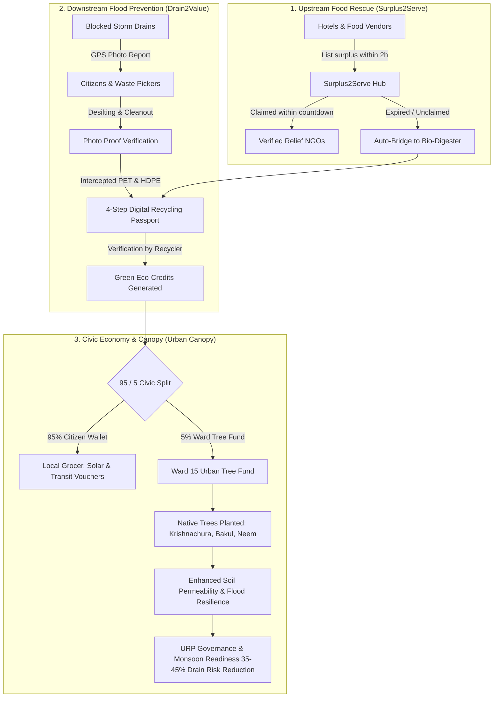

# 🌿 UrbanLoop — Circular Civic Ecology
### Closed-Loop Civic Tech for Food Rescue, Flood Resilience & Urban Afforestation

[](https://react.dev/)
[](https://www.typescriptlang.org/)
[](https://vitejs.dev/)
[](https://tailwindcss.com/)
[](https://threejs.org/)
[](https://ai.google.dev/)
[](https://firebase.google.com/)
[](LICENSE)

---

**UrbanLoop** is an open-source, full-stack civic ecology platform designed to solve interconnected urban environmental crises in fast-growing global cities. Piloted for **Ward 15 (Dhanmondi, Dhaka)**, UrbanLoop creates a unified circular metabolism across three core civic vectors:

1. **Upstream Food Interception (`Surplus2Serve`)**: Rescuing commercial and banquet surplus food under strict thermal safety protocols before expiry, and automatically converting unclaimed batches into bio-composting passports.
2. **Downstream Flood Mitigation (`Drain2Value 2.0`)**: Crowdsourcing drain desilting bounties with GPS-tagged before/after photo audits, diverting intercepted polymers into digital recycling passports to prevent catastrophic monsoon waterlogging.
3. **Autonomous Urban Afforestation (`Urban Canopy`)**: Enforcing a **95/5 Civic Split** on earned Green Credits—where 95% goes to personal citizen vouchers and 5% automatically finances native deep-root urban tree planting along canals and walkways.

---

## 🧭 The Circular Ecology Loop



---

## ✨ Key Platform Features

### 1. 🗺️ Command Map & 3D Interactive Digital Twin
- **Bilingual Geographic Telemetry**: Real-time Leaflet map of Ward 15 showing surplus food pins, desilted/blocked drain hotspots, collection hubs, and geo-tagged native saplings.
- **Procedural 3D Ward Simulator (`Three.js`)**: Real-time rendering of Dhanmondi Ward with PBR lighting (PMREM RoomEnvironment), dynamic day/night cycles (Noon, Sunset, Night), live rain particles, and interactive camera focus points (Lake Sluice, Arterial Drains, Vendor Market, Urban Canopy).

### 2. 🍲 Surplus2Serve Portal
- **Perishable Countdown Timers**: Strict 2-hour window timers adhering to BSTI and international food hygiene protocols.
- **AI-Generated Thermal Packing Standards**: Calls Gemini API to provide precise food-grade insulation guidelines (`>60°C` for cooked food, `<4°C` for cold chain) with anti-hallucination safety policies.
- **Automated Bio-Compost Bridge**: Any listing that expires uncollected is locked and instantly routed into a bio-digestion passport batch to avoid landfill methane emissions.

### 3. 📜 Proof-of-Recycling Passport
- **4-Step Custody Chain**: Tracks intercepted plastic waste (PET, HDPE rigid) and organic bio-compost across:
  `1. Handover Logged` ➔ `2. Transit Verification` ➔ `3. Recycler Reception` ➔ `4. Processing & Credit Issuance`.
- **Bioscience Modal**: Embedded educational modal detailing anaerobic digestion vs. composting chemistry, Carbon-to-Nitrogen (C:N) ratios, thermophilic bacterial phases, and methane abatement metrics.

### 4. 🌊 Drain Bounty & Monsoon Missions
- **Crowdsourced Hydrologic Bounties**: Critical hotspots (Dhanmondi Lake Culvert, Satmasjid Sluice, Road 27 Chute) offer 50–75 Green Credits per desilting.
- **Before/After Verification Engine**: Enforces photographic evidence with geolocation and bag counts before credits are released.
- **Urgent Cloudburst Quests**: Emergency missions triggered when monsoon rainfall exceeds storm drain thresholds.

### 5. 💳 Green Wallet & The 95/5 Civic Split
- **Autonomous Micro-Giving**:
  - **95%**: Retained in user's personal wallet to redeem for fresh produce, rickshaw/bus transit passes, certified seeds, or solar charging coupons.
  - **5%**: Non-negotiable communal deduction routed into the **Ward 15 Tree Fund**.
- **Canopy Registry**: Live ledger of planted saplings (Bakul, Jarul, Neem, Krishnachura) with estimated kg CO₂ offset/year and health tracking.

### 6. 🏛️ URP Governance & Monsoon Simulator
- **Ward Cleanliness Dividend**: Live progress bar tracking the municipal milestone toward community waste-diversion rewards.
- **Hydrology Impact Simulator**: Adjust drain de-silting ratios and upstream diversion to calculate surface waterlogging duration reductions.
- **AI Executive Briefing Generator**: Gemini-powered tool that synthesizes telemetry into official mayoral policy briefs for the City Corporation.

### 7. 🤖 Dual-Language Gemini AI Civic Copilot
- **Multi-Turn Assistant (`gemini-3.8-flash`)**: Dual-language support (**English** and **বাংলা**) with context-aware responses on food handling, local recycling rules, bounty audits, and urban ecology.
- **Domain-Heuristic Fallbacks**: Built-in domain fallbacks ensure 100% operational uptime even without an active internet connection or API quota.

---

## 👥 Multi-Stakeholder Role Switcher

Test the full platform workflow from any civic perspective using the built-in role switcher:

| Role | Primary Activities | Key View |
|:-----|:-------------------|:---------|
| 🏪 **Food Vendor** | Post surplus catering/meals, receive packaging guidelines, view expiry timers | `/surplus-serve` |
| 🤝 **Relief NGO** | Claim and dispatch pickups for safe food batches to feed vulnerable shelters | `/surplus-serve` |
| 🧤 **Waste Collector / Citizen** | Report choked culverts, submit before/after desilting photos, redeem vouchers | `/drain-bounty`, `/green-wallet` |
| 🏛️ **URP Urban Planner** | Audit photo submissions, inspect 3D flood model, generate mayoral readiness briefs | `/urp-governance` |

---

## 🛠️ Technology Stack

| Layer | Technologies |
|:------|:-------------|
| **Frontend Framework** | [React 19](https://react.dev/), [TypeScript](https://www.typescriptlang.org/), [Vite 8](https://vitejs.dev/) |
| **Styling & UI** | [Tailwind CSS v4](https://tailwindcss.com/), [Lucide React](https://lucide.dev/), [Motion](https://motion.dev/) |
| **3D & Visualizations** | [Three.js](https://threejs.org/) (PBR, RoomEnvironment, procedural city geometry), [Recharts](https://recharts.org/) |
| **Mapping** | OpenStreetMap, Leaflet / Custom Geo-layers, Nominatim Geocoding |
| **Artificial Intelligence** | Google GenAI SDK (`@google/genai`) using `gemini-3.8-flash` & `gemini-2.5-flash` |
| **Cloud & Backend** | [Firebase](https://firebase.google.com/) (Auth, Firestore Security Rules v2, Applet Config) |

---

## 🚀 Quick Start & Local Setup

### Prerequisites
- [Node.js](https://nodejs.org/) (version 18+ or 20+ recommended)
- `npm` or `bun`

### 1. Clone & Install
```bash
git clone https://github.com/your-username/UrbanLoop---Circular-Civic-Ecology.git
cd UrbanLoop---Circular-Civic-Ecology
npm install
```

### 2. Configure Environment Variables
Copy `.env.example` to `.env` or `.env.local`:
```bash
cp .env.example .env.local
```
Update with your Gemini API key (get one free at [Google AI Studio](https://aistudio.google.com/)):
```env
GEMINI_API_KEY=your_gemini_api_key_here
```
> *Note: UrbanLoop includes resilient fallback engines; the app will still function seamlessly if no API key is provided.*

### 3. Launch Development Server
```bash
npm run dev
```
Open [http://localhost:3000](http://localhost:3000) in your browser.

### 4. Build for Production
```bash
npm run build
npm run preview
```

---

## 📱 Dual Viewports: Web & Mobile Simulator

UrbanLoop features an instant toggle between:
- **Desktop Web Experience**: High-density command center layout with multi-column analytics, 3D simulation canvas, and detailed telemetry tables.
- **Mobile Device Frame**: Emulated mobile smartphone viewport with bottom navigation tab-bar, optimized for field workers and on-the-go waste collectors.

Toggle between modes at any time via the **Monitor / Smartphone** toggle button in the top navigation bar.

---

## 📂 Project Structure

```
UrbanLoop---Circular-Civic-Ecology/
├── public/                 # Static assets & icons
├── src/
│   ├── components/
│   │   ├── chat/           # Gemini AI Civic Chat Interface & Floating Widget
│   │   ├── layout/         # Header, Mobile Tab Bar, Toast Notifications
│   │   ├── pages/          # 7 Core Pages:
│   │   │   ├── CommandMapPage.tsx
│   │   │   ├── SurplusServePage.tsx
│   │   │   ├── RecyclingPassportPage.tsx
│   │   │   ├── DrainBountyPage.tsx
│   │   │   ├── GreenWalletPage.tsx
│   │   │   ├── UrpGovernancePage.tsx
│   │   │   └── CivicChatPage.tsx
│   │   ├── science/        # Compost Bioscience educational modal & formulas
│   │   ├── three/          # Ward3DScene procedural Three.js digital twin
│   │   └── wallet/         # Voucher redemption cards & tree fund counters
│   ├── context/            # UrbanLoopContext: Global circular state machine
│   ├── data/               # Seed data for Ward 15 telemetry, trees, vouchers
│   ├── firebase/           # Firebase SDK initialization & config
│   ├── services/           # Gemini AI integrations (packing, URP brief, chat)
│   ├── types.ts            # TypeScript interfaces & domain types
│   ├── App.tsx             # Root routing and responsive shell
│   ├── main.tsx            # React root mount
│   └── index.css           # Tailwind CSS imports & theme rules
├── firestore.rules         # Security Rules for user, listing, and bounty data
├── firebase.json           # Firebase Hosting & Firestore configuration
└── package.json            # Project dependencies & scripts
```

---

## 🌍 UN Sustainable Development Goals (SDG) Alignment

UrbanLoop was engineered around explicit targets in the UN 2030 Agenda:

| SDG | Goal Name | UrbanLoop Mechanism |
|:---:|:---|:---|
|  | **Zero Hunger** | Routes edible catering surplus to vetted shelters within 2 hours. |
|  | **Clean Water & Sanitation** | Prevents solid polymers from damming lake inlets and urban drainage outfalls. |
|  | **Sustainable Cities** | Pre-monsoon drain desilting reduces urban waterlogging duration by 35–45%. |
|  | **Responsible Consumption** | Diverts organic waste into compost passports, creating a closed loop. |
|  | **Climate Action** | Abates anaerobic landfill methane emissions and mitigates urban flash floods. |
|  | **Life on Land** | Autonomous 5% Tree Fund finances native canopy planting along lake walkways. |

> **System Boundaries & Honesty Disclaimers:**
> - UrbanLoop **does not** perform biochemical or lab food safety testing (SDG 3); it enforces temperature containment guidelines and strict time windows.
> - UrbanLoop **does not** replace heavy civil municipal stormwater tunneling (SDG 9); it provides decentralized maintenance and choke-point prevention.

---

## 🔒 Security & Privacy

- **Data Integrity**: Cloud Firestore security rules prevent unauthorized modifications and scraping.
- **Safe AI**: Prompt engineering strictly isolates generative responses to operational hygiene and resilience parameters, avoiding medical or regulatory liability.

---

## 📄 License

This project is licensed under the **Apache License 2.0** — see the [LICENSE](LICENSE) file for details. Built for civic open-source collaboration.